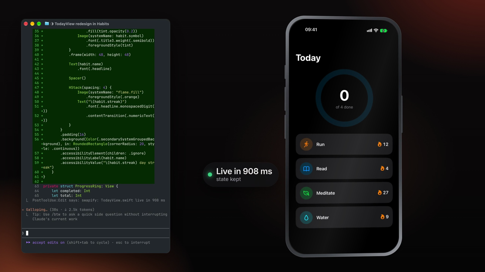

<p align="center">
  
</p>

<h1 align="center">swapify</h1>

<h3 align="center">Agentic hot reload for iOS apps.</h3>

<p align="center">
  
</p>

swapify patches Swift edits into an iOS app that is already running in the simulator. Only the edited file is recompiled. The app keeps its screen, its navigation stack, `@State`, and its data. The agent gets a screenshot and the visible text back, so it can check what it did before it does the next thing.

A one-line edit to a view in a 979-file TCA app: 10.2 s to rebuild and relaunch, back at the first screen. 1.2 s with swapify, on the same screen.

## Let the agent see what it did

`swapify init` installs a Claude Code hook. After every `Edit` or `Write` of a Swift file, the hook reloads it. You see one line under the edit:

```text
⎿ PostToolUse:Edit says: swapify: TodayView.swift live in 698 ms
```

The agent reads the whole result, with a screenshot it can open:

```text
swapify: TodayView.swift is live in the running app (generation 2, 894 ms).
Screenshot: .swapify/screens/reload-2.png. Visible text: Today | 0 of 4 done | Run | 12 days | …
```

If the file does not compile, the agent gets the compiler errors and the app keeps running the last code that compiled. If the edit changes the memory layout of a type, the agent is told to rebuild, and nothing is patched.

The image above is a frame of the landing page film, cut from one take of a real screen: Claude Code redesigns a plain list into a progress ring, cards, and tap-to-complete in 6 edits and 70 seconds, then taps two habits to check the result. Each edit is live in the app in 681 to 908 ms. The [landing page](https://github.com/tornikegomareli/swapify-site) plays it.

## Try things, keep what works

When a check costs a rebuild, an agent writes a lot and checks rarely. When a check costs a second, it works in small steps: change one thing, look, keep it or take it back.

| One-line edit | Rebuild and relaunch | swapify |
|---|---|---|
| `Examples/Habits`, 3 files | 3.3 s, state lost | 0.7 s, state kept |
| A 979-file TCA app | 10.2 s, state lost | 1.2 s, state kept |

Rebuild is an incremental `xcodebuild`, `simctl install`, and `simctl launch`, measured on Apple silicon with Xcode 27.2. It does not count the walk back to the screen you were on.

## Test behavior, not only pixels

```sh
swapify tap "Run"        # activates the element with that accessibility label or identifier
swapify ui               # every visible element, top to bottom, with traits and frames
swapify screenshot       # the app at 1x; --full for the whole simulator screen
```

In the session above, the agent taps two habits, reads the screen, and checks that the ring says 2 of 4 and both streaks went up.

## Every agent, not only Claude Code

```sh
codex mcp add swapify -- swapify mcp
claude mcp add swapify -- swapify mcp
```

The MCP server has the same loop as tools: `reload`, `ui`, `tap`, `screenshot`, `run`, `status`. It speaks MCP 2026-07-28 and the earlier `initialize`-based versions. See [docs/agents.md](docs/agents.md).

## Install

```sh
brew tap tornikegomareli/swapify https://github.com/tornikegomareli/swapify
brew install --HEAD swapify
```

Or from a clone: `make install PREFIX=/usr/local`.

Requirements:

- An Apple silicon Mac
- Xcode 26 or later, and an iOS 26 or later simulator (tested with Xcode 27.2 and iOS 27.2)

## Using it

```sh
cd MyApp                 # the directory with your .xcodeproj or .xcworkspace
swapify init             # swapify.json, .gitignore, the Claude Code hook and skill, .mcp.json
swapify run              # Debug build with reload support, boots a simulator, launches the app
swapify reload MyApp/Views/HomeView.swift
swapify doctor           # checks the Mac, Xcode, the project, the build, the simulator, the app
```

Your Xcode project does not change. `swapify run` passes the settings it needs on the `xcodebuild` command line and keeps its own DerivedData in `.swapify/`. `run`, `reload`, `ui`, and `doctor` accept `--json`.

| Change | Result |
|---|---|
| Bodies of functions, methods, initializers, computed properties | Live |
| SwiftUI view structure and modifiers | Live, `@State` kept |
| New functions, new types, `private` helpers | Live |
| Files in Swift packages that the app builds | Live |
| A stored property added, removed, renamed, or retyped | Rebuild |
| A method added to or removed from a non-final class | Rebuild |
| A new file, resources, `Info.plist`, dependencies | Rebuild |

## How it works

There are no private Apple services involved. It is one compiler flag, one `dlopen`, and four kinds of pointer write. [docs/architecture.md](docs/architecture.md) has every offset.

### One pointer per function

Build a Swift file with `-enable-implicit-dynamic` and every function gets a prologue:

```llvm
%r = call ptr @swift_getFunctionReplacement(ptr @"$s3App6reportyySSFTX", ptr @"$s3App6reportyySSF")
br (%r == null), label %original_entry, label %forward_to_replaced
```

`$s…TX` is the function's chain root, a pointer in writable data. If it points back at the function, the function runs its own body. If it points elsewhere, the function jumps there. swapify compiles the edited file unchanged, with the exact `swift-frontend` command Xcode used, links it into a dylib, and the in-app agent `dlopen`s it. Then it copies each new root into the matching old root. Direct calls, vtable dispatch, and protocol witnesses all go through that one pointer, so every caller now runs the new body. `private` functions too: their mangled names depend on the file name, which does not change.

### Two copies of every type, one identity

The patch is a compile of the whole file, so it brings its own copy of every type, static, and conformance in it. Left alone, new code would allocate instances of a second `TaskModel` class, read a second copy of every `static let`, and show SwiftUI a different `TaskRow` type, which drops its `@State`.

So the patch is pointed back at the app. Each metadata accessor (`$s…Ma`), addressor (`$s…vau`), and witness table accessor (`$s…Wl`, `$s…Wa`) in the patch gets its first 16 bytes replaced with `ldr x16, #8; br x16` and the address of the app's original. The app's field offsets (`$s…Wvd`) and witness tables (`$s…WP`) are copied into the patch. Simulator processes are ad hoc signed and not hardened, so writing a private copy of a code page is allowed. A device does not allow it.

### A guard instead of a crash

New code runs on old objects, so a patch must not change their layout. Before writing anything, the agent compares every nominal type descriptor (`$s…Mn`) in the patch with the app's: vtable size, field count, and each field's name, `let` or `var`, and type. Symbolic references in type names point into different images, so they are compared by the name of the type they reference. If anything differs, the patch stays loaded and inert, and the agent reports which type changed and why.

### Redraw without forgetting

SwiftUI does not know that a `body` changed. Xcode Previews handles this in `AppPreviewHost.invalidateEverything()`: it bumps the view phase, invalidates every value in the AttributeGraph, and flushes a transaction. swapify does the same for each `_UIHostingView`, without the phase bump, because a new phase is what resets `@State`. The functions are exported from SwiftUI and AttributeGraph; the agent calls them through `dlsym` with Swift's calling convention. Then it renders the windows at 1x with `drawViewHierarchyInRect:afterScreenUpdates:YES` and reads the accessibility tree.

### Where the time goes

A warm reload of a SwiftUI view file:

| Step | ms |
|---|---|
| Compile the edited file | 230 |
| Link the patch | 210 |
| `dlopen`, guard, patch | 14 |
| SwiftUI redraw | 5 |
| Snapshot and visible text | 53 |
| Edit to verified screen | 512 |

A reload costs what compiling that one file costs. A 495-line TCA reducer takes 9.6 s to type-check by itself; a view file takes a fraction of a second. The first patch in a process pays about 800 ms for `dlopen`, so `swapify run` reloads one unchanged file right after launch.

## Limits

- Simulator and Apple silicon only, Debug builds only.
- The SwiftUI redraw calls functions by their mangled names. If a future iOS renames them, reloads still apply and views redraw on their next state change. `swapify doctor` reports it.
- UIKit screens do not redraw by themselves. Observe the `SwapifyDidReload` notification to rebuild one.
- The app must be in the foreground: iOS suspends background apps.

## Remove

```sh
brew uninstall swapify && brew untap tornikegomareli/swapify
```

In a project, delete `swapify.json`, `.swapify/`, the `swapify` entry in `.mcp.json`, `.claude/skills/swapify/`, and the swapify hook in `.claude/settings.json`.

## Development

```sh
swift build          # builds the CLI; the in-app agent is built on demand from Agent/
make test            # unit tests
make e2e             # the whole pipeline against Examples/Showcase in a simulator
```

[CONTRIBUTING.md](CONTRIBUTING.md) explains the layout and how to check the SwiftUI symbols on a new iOS version. [docs/protocol.md](docs/protocol.md) is the agent's wire protocol, and [docs/troubleshooting.md](docs/troubleshooting.md) covers the common failures.

## License

[MIT License](LICENSE).
