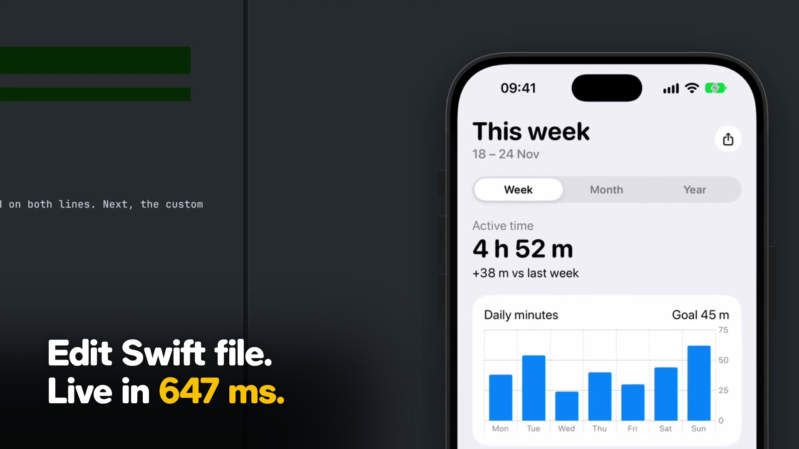

<h1 align="center">swapify</h1>

<h3 align="center">Hot reload for coding agents on iOS.</h3>

<p align="center">
  
</p>

swapify is an open-source command-line tool for iOS projects. When a coding agent edits a Swift file, swapify compiles that file and loads it into the app that is already running, in the iOS Simulator or on an iPhone. The app keeps its screen, its navigation stack and its `@State`. The agent gets a screenshot and the visible text back, so it can check each change before it makes the next one.

It works with Claude Code, Codex, Cursor and any other MCP client
## Install

```sh
brew tap tornikegomareli/swapify https://github.com/tornikegomareli/swapify
brew install swapify
```

To build the latest `main` instead, use `brew install --HEAD swapify`, or `make install PREFIX=/usr/local` from a clone.

Requirements:

- An Apple silicon Mac
- Xcode 26 or later
- An iOS 26 or later simulator, or an iPhone with iOS 26 or later (tested with Xcode 27.2 and iOS 27.2)

## Run it in a project

```sh
cd MyApp          # the folder with your .xcodeproj or .xcworkspace
swapify init      # writes swapify.json, the Claude Code hook and skill, and .mcp.json
swapify run       # builds a Debug app with reload support and launches it in the simulator
```

Your Xcode project does not change. `swapify run` passes the settings it needs on the `xcodebuild` command line and keeps its own DerivedData in `.swapify/`.

Then work with your agent as usual. After each edit of a Swift file, the Claude Code hook reloads it and shows one line under the edit:

```text
⎿ PostToolUse:Edit says: swapify: TodayView.swift live in 698 ms
```

The agent gets the full result, with a screenshot it can open:

```text
swapify: TodayView.swift is live in the running app (generation 2, 894 ms).
Screenshot: .swapify/screens/reload-2.png. Visible text: Today | 0 of 4 done | Run | 12 days | …
```

If the file does not compile, the agent gets the compiler errors, and the app keeps running the last code that compiled. If an edit changes the memory layout of a type the app was built with, the agent is told to run `swapify run` again, and nothing is loaded.

Other agents use the MCP server, which has the same steps as tools: `reload`, `ui`, `tap`, `screenshot`, `run` and `status`.

```sh
codex mcp add swapify -- swapify mcp
claude mcp add swapify -- swapify mcp
```

[docs/agents.md](docs/agents.md) has the setup for each agent.

For hand edits, for example in Xcode, run `swapify watch` in a second terminal after `swapify run`. It reloads the Swift files of the project each time you save them, new files too, and prints one line for each reload:

```text
swapify: TodayView.swift live in 698 ms
```

A save that does not change the text does nothing. Ctrl-C stops the watch.

## Simulator or iPhone

|  | Simulator | iPhone |
|---|---|---|
| Start | `swapify run` | `swapify run --device` |
| Which one | the last run's simulator if it is booted, then a booted one, then the newest iPhone; `--udid` picks one | the connected iPhone; `--udid <name or UDID>` picks one of several |
| Needs | an iOS 26 or later simulator | iOS 26 or later, paired with the Mac by cable or Wi-Fi, Developer Mode on, a signing team in the project |
| Connection | `127.0.0.1` | the CoreDevice tunnel, encrypted; the agent in the app accepts only the token of the current launch |
| A reload of a view file | about 0.5 s | about 1.3 s over Wi-Fi, including the screenshot coming back |

On an iPhone, the app runs without a debugger. The screen stays on while the swapify-launched app runs, and locking the phone by hand still works. The phone must be unlocked for a reload.

After either `run`, the other commands work the same way:

```sh
swapify reload MyApp/Views/HomeView.swift
swapify ui                 # every visible element, top to bottom, with traits and frames
swapify tap "Run"          # taps the element with that accessibility label or identifier
swapify screenshot         # the app at 1x; --full for the whole screen
swapify doctor             # checks the Mac, Xcode, the project, the build, the simulator or iPhone, and the app
```

`run`, `reload`, `watch`, `ui` and `doctor` accept `--json`.

## What reloads

| Change | Result |
|---|---|
| Bodies of functions, methods, initializers, computed properties | Live |
| SwiftUI view structure and modifiers | Live, `@State` kept |
| New functions, new types, `private` helpers | Live |
| A new Swift file in a folder with app files, or below one | Live |
| Stored properties of a type created since the last build | Live |
| Files in Swift packages that the app builds | Live |
| The initial value of a `static let` or a global constant, changed | Keeps the old value: the app computes it once, with the code it was built with, the first time it is read. A computed property (`static var x: T { … }`) is live |
| A stored property of a type the app was built with: added, removed, renamed, or retyped | Rebuild |
| A method added to or removed from a non-final class | Rebuild |
| A deleted file, resources, `Info.plist`, dependencies | Rebuild |

## How it works

swapify uses no private Apple services. It is one compiler flag, one `dlopen`, and pointer writes. [docs/architecture.md](docs/architecture.md) has every offset.

1. **Build once.** `swapify run` builds the app with `-enable-implicit-dynamic`. Every function then starts by reading its chain root, `$s…TX`, a pointer in writable data. If the pointer names a new body, the function jumps there.
2. **Compile the changed files.** swapify compiles each Swift file changed since the build, in parallel, with the exact `swift-frontend` command Xcode used for it. A new file borrows the command of a file next to it. The objects are linked into a small dylib.
3. **Check the layout.** New code runs on objects the app already made, so their layout must not change. swapify compares each type the app was built with against the new code: stored properties and their types, and the vtable of each class. If one differs, nothing is loaded, and the agent is told why.
4. **Load and repoint.** An agent inside the app `dlopen`s the patch and copies each new chain root into the old one. Direct calls, vtables and protocol witnesses all go through that pointer, so every caller runs the new body. Each type keeps one identity, so existing objects, statics and `@State` stay valid. In the simulator, the patch's type accessors jump to the app's originals. On an iPhone, where a process cannot write code, the patch is built so that dyld binds it to the app's types when it loads.
5. **Redraw.** SwiftUI does not know that a `body` changed. For each hosting view, swapify invalidates the AttributeGraph and flushes a transaction, as Xcode Previews does, without the phase bump that resets `@State`.
6. **Report.** The agent in the app renders the windows at 1x and reads the accessibility tree. The screenshot and the visible text go back to the coding agent.

A warm reload of a SwiftUI view file in the simulator takes about 512 ms: 230 ms to compile, 210 ms to link, 14 ms to load and check, 5 ms to redraw, and 53 ms for the screenshot and text. A reload costs what compiling the changed files costs, so a file that is slow to type-check reloads slowly.

## Limits

- Apple silicon Macs and Debug builds only.
- The SwiftUI redraw calls functions by their mangled names. If a future iOS renames them, reloads still apply and views redraw on their next state change. `swapify doctor` reports it.
- UIKit screens do not redraw by themselves. Observe the `SwapifyDidReload` notification to rebuild one.
- The app must be in the foreground, because iOS suspends background apps.

## Remove

```sh
brew uninstall swapify && brew untap tornikegomareli/swapify
```

In a project, delete `swapify.json`, `.swapify/`, the `swapify` entry in `.mcp.json`, `.claude/skills/swapify/`, and the swapify hook in `.claude/settings.json`.

## Development

```sh
swift build                          # the CLI; the agent inside the app is built from Agent/
make test                            # unit tests
make e2e                             # the whole pipeline against Examples/Showcase in a simulator
python3 -I scripts/e2e.py --device   # the same on the connected iPhone (Showcase needs a signing team)
scripts/release.sh 0.1.0             # tags and publishes a release; see the script's header
```

[CONTRIBUTING.md](CONTRIBUTING.md) explains the layout and how to check the SwiftUI symbols on a new iOS version. [docs/protocol.md](docs/protocol.md) is the wire protocol between the CLI and the agent in the app, and [docs/troubleshooting.md](docs/troubleshooting.md) covers the common failures.

## License

swapify is open source under the [MIT License](LICENSE).
